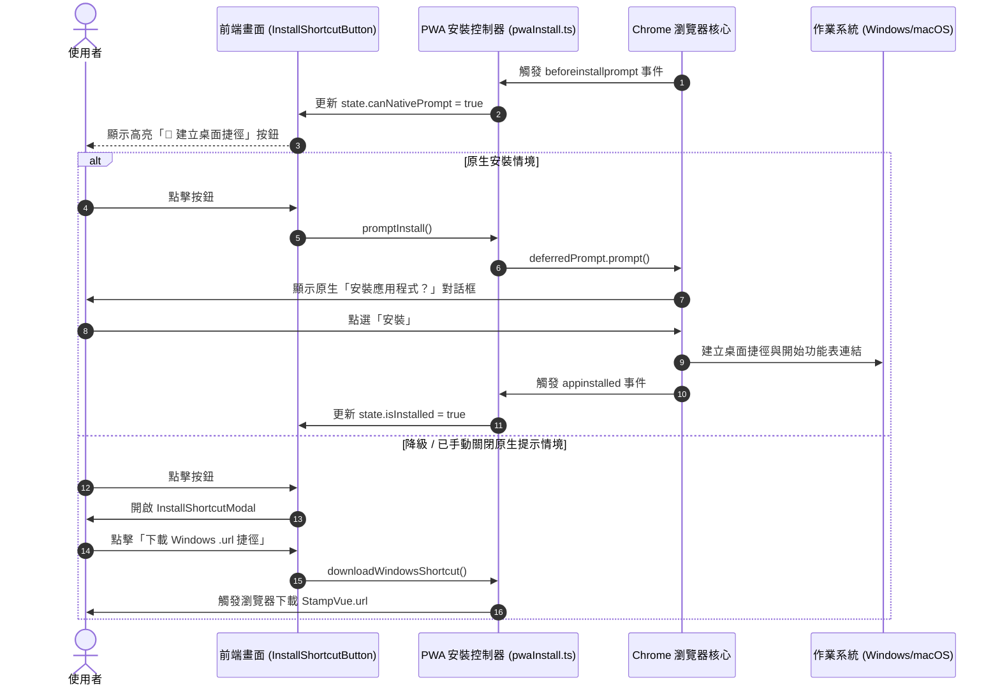

# Tech Spec: PWA 一鍵產生 Chrome 桌面捷徑與安裝技術規格

> **關聯 PRD**: [PRD 文件連結](file:///docs/sdlc/PRD-pwa-chrome-shortcut.md)  
> **架構設計人**: Antigravity (資深軟體架構師)  
> **狀態**: 已定案 (Finalized)  
> **最後更新**: 2026-10-16  

---

## 1. 架構設計與資料流 (System Architecture & Data Flow)



---

## 2. 元件與檔案清單 (File Structure & Components)

```
frontend/
├── public/
│   ├── manifest.webmanifest   # PWA 清單定義檔
│   ├── sw.js                  # 輕量級 Service Worker (資源離線快取與安裝資格)
│   ├── favicon.svg            # 應用圖示 (向量格式)
│   ├── icon-192.png           # 192x192 標籤圖示 (PWA 必要)
│   └── icon-512.png           # 512x512 標籤圖示 (PWA 必要)
└── src/
    ├── utils/
    │   └── pwaInstall.ts      # PWA 狀態偵測、事件監聽與捷徑下載輔助函式
    ├── components/
    │   ├── InstallShortcutButton.vue # 響應式快捷安裝按鈕
    │   └── InstallShortcutModal.vue  # 教學與降級下載彈窗
    ├── index.html             # 引入 manifest 與 service worker 註冊
    └── App.vue                # 頂部/工具列掛載安裝按鈕
```

---

## 3. 資料結構與介面契約 (Data Contracts & Types)

### 3.1 PwaInstallState
```typescript
export interface PwaInstallState {
  isInstalled: boolean;       // 是否已在 Standalone 獨立視窗中執行
  canNativePrompt: boolean;   // 是否有可觸發的 beforeinstallprompt
  isChrome: boolean;          // 是否檢測為 Chromium / Chrome 核心
  showFallbackModal: boolean; // 是否開啟備用下載/手動指引彈窗
}
```

### 3.2 Manifest 配置範例 (`public/manifest.webmanifest`)
```json
{
  "name": "StampVue - 專業印章去背工具",
  "short_name": "StampVue",
  "description": "專業印章去背、陰影消除、印鑑提取工具",
  "start_url": "./",
  "scope": "./",
  "display": "standalone",
  "background_color": "#0f172a",
  "theme_color": "#ef4444",
  "icons": [
    {
      "src": "./icon-192.png",
      "sizes": "192x192",
      "type": "image/png",
      "purpose": "any maskable"
    },
    {
      "src": "./icon-512.png",
      "sizes": "512x512",
      "type": "image/png",
      "purpose": "any maskable"
    },
    {
      "src": "./favicon.svg",
      "sizes": "any",
      "type": "image/svg+xml"
    }
  ]
}
```

---

## 4. 關鍵技術決策與權衡 (Trade-offs & Decisions)

1. **Service Worker 策略**：
   - 保持極簡與安全，使用 Stale-While-Revalidate 或網路優先策略快取核心 HTML/JS/CSS，不侵入使用者的印章圖檔處理運算（圖片處理純本地前端記憶體進行）。
2. **Vue 2.7 相容性**：
   - 專案使用 Vue 2.7.16 + Composition API (`<script setup lang="ts">`)，實作中使用純 Typescript 模組 + 響應式 `ref` / `reactive`，確保在 Vue 2.7 下具備 100% 型別安全與生命週期整合。
3. **高解析度 PNG 圖示產生**：
   - 透過 Node.js 向量轉繪 Canvas 腳本快速產生清晰的印章 192x192 與 512x512 圖示，保證符合 Chrome PWA Installability 標準。
